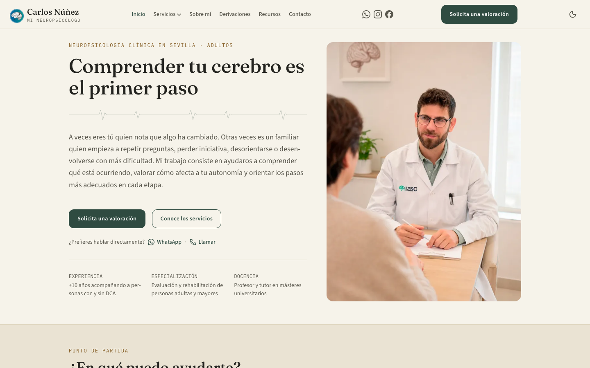
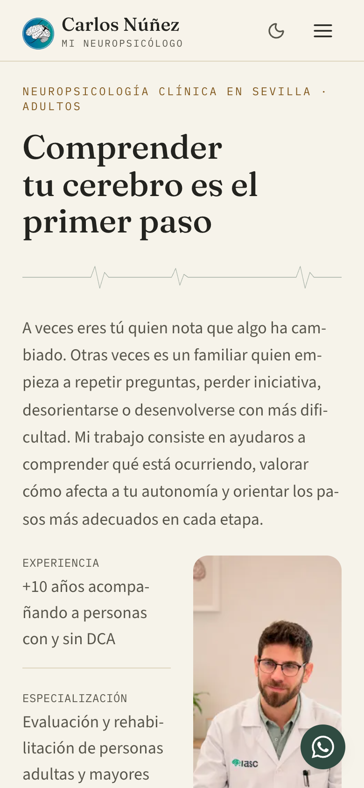

# mineuropsicologo.es — web profesional para un neuropsicólogo clínico

> **English summary.** Showcase repository for a real freelance project: the website of Carlos Núñez, a clinical neuropsychologist in Seville (Spain). I designed and built it end to end with Astro and Tailwind CSS: accessible, mobile-first, fast and technically optimised for search. Lab audits (PageSpeed Insights / Lighthouse) score 99–100 in performance and 100 in SEO. The client's source code is private, so this repository only documents the work. Live site: <https://mineuropsicologo.es>

**Una web clínica rápida, accesible y preparada para que los pacientes y otros profesionales sanitarios encuentren a su neuropsicólogo.**

🔗 **Sitio en producción:** [https://mineuropsicologo.es](https://mineuropsicologo.es)

📄 **Caso de estudio:** [fherrera.dev/casos-de-estudio/web-neuro](https://fherrera.dev/casos-de-estudio/web-neuro)

> El código del proyecto pertenece al cliente y es privado. Este repositorio es un escaparate: describe qué se hizo y cómo, con permiso del cliente para mencionarlo y enlazarlo.

## Capturas

| Escritorio (1440 px) | Móvil (390 px) |
| :---: | :---: |
|  |  |

## La necesidad del cliente

Carlos Núñez, neuropsicólogo clínico en Sevilla, necesitaba una presencia web propia que transmitiera confianza y explicara con claridad sus servicios a pacientes y familias, y que además sirviera de canal de derivación para otros profesionales sanitarios. Debía ser:

- **Clara y sobria**, acorde con un ámbito sanitario, con todo el contenido en español.
- **Accesible y cómoda en móvil**, porque buena parte de las visitas llegan desde el teléfono.
- **Visible en buscadores** para consultas locales y de servicio (valoración neuropsicológica, TDAH, daño cerebral, neurofeedback, mapeo cerebral…).
- **Fácil de mantener**, con despliegue automático y sin servidor propio.

## Qué hice

Diseño, desarrollo, optimización y puesta en producción del sitio completo, de forma individual.

**Diseño y componentes**
- Sistema de diseño propio con tokens de color, radios y sombras, y modo claro/oscuro.
- Biblioteca de componentes tipados y un layout único para las seis páginas de servicios, con navegación por secciones y ritmo visual coherente.
- Tipografías autoalojadas para no depender de terceros.

**Accesibilidad y adaptación móvil**
- Diseño responsive revisado desde 320 px hasta pantallas grandes, sin desbordes horizontales.
- Navegación por teclado, enlace para saltar al contenido, atributos ARIA en los componentes interactivos y respeto de `prefers-reduced-motion`.
- Menú móvil, acordeones y carrusel accesibles.

**Páginas y contenido**
- Home, sobre mí, contacto, derivación para profesionales, seis páginas de servicios clínicos y páginas legales.
- Sección de recursos con 22 artículos en Markdown validados con esquema, filtrado por categoría, artículos relacionados e imágenes de portada.
- Reseñas de Doctoralia sincronizadas automáticamente cada semana.

**SEO técnico**
- Datos estructurados JSON-LD (organización médica, persona, artículos, preguntas frecuentes y migas de pan), Open Graph, canonical y sitemap con fechas reales.
- Redirecciones 301 de URLs antiguas y página 404 útil.
- Auditoría SEO con datos de Search Console y mejoras derivadas: títulos, enlazado interno y estructura de los artículos.

**Rendimiento y seguridad**
- Imágenes responsive en WebP con carga diferida, y vídeo y carrusel optimizados.
- Caché larga para recursos estáticos, compresión y cabeceras de seguridad.

**Formularios y despliegue**
- Formularios de contacto y derivación con mejora progresiva, campo trampa anti-spam y gestión controlada de errores.
- Despliegue continuo: cada cambio en la rama principal se compila y se publica automáticamente.

## Stack

| Área | Tecnología |
| :--- | :--- |
| Framework | Astro 7 (salida estática) |
| Estilos | Tailwind CSS 4 |
| Lenguajes | TypeScript, Astro, HTML, CSS |
| Contenido | Content Collections (Markdown) con validación Zod |
| Iconos y fuentes | astro-icon (Lucide), Fontsource |
| Formularios | Web3Forms |
| Hosting y CI/CD | Firebase Hosting y GitHub Actions |

## Resultados

Mediciones de laboratorio con PageSpeed Insights (Lighthouse) el **9/11/2026**, sobre 7 páginas clave de la web publicada, en móvil y escritorio:

| Categoría | Resultado |
| :--- | :--- |
| Rendimiento | 99–100 en las 14 mediciones |
| SEO | 100 en todas |
| Buenas prácticas | 100 en todas |
| Accesibilidad | 96 en una única medición (home en escritorio, por el contraste de un enlace); el resto, sin incidencias detectadas por la herramienta |

Otros datos de esas mediciones: LCP de 0,2–0,4 s en escritorio y 0,9–2,0 s en móvil, CLS ≤ 0,03 y TBT de 0 ms.

Estas cifras son de laboratorio, no datos de campo: el sitio es reciente y aún no tiene tráfico suficiente para tener datos reales de usuarios.

Además:
- Sitio completo de 40 páginas, con redirecciones, sitemap y datos estructurados en todas las rutas.
- Despliegue automático y actualización semanal de reseñas sin intervención manual.

## Mi papel

Diseñé y desarrollé el sitio completo en solitario como freelance: la arquitectura, el sistema de diseño y los componentes, las páginas y la estructura de contenido, el SEO técnico, la optimización de rendimiento y accesibilidad, los formularios, y la puesta en producción con despliegue continuo y mantenimiento posterior.

El desarrollo se ha apoyado en herramientas de IA (asistentes de programación) como acelerador: yo defino los requisitos, las decisiones de arquitectura y de producto, reviso el código generado y valido el resultado de cada hito.

## Sobre el código

El código fuente pertenece al cliente y es privado. Puedo enseñarlo y explicarlo en una entrevista.

## Contacto

Fernando Herrera Monroy — Desarrollador full-stack con especialidad en Android.

📧 [contacto@fherrera.dev](mailto:contacto@fherrera.dev) · Web: [fherrera.dev](https://fherrera.dev) · GitHub: [@ferchio9](https://github.com/ferchio9)
